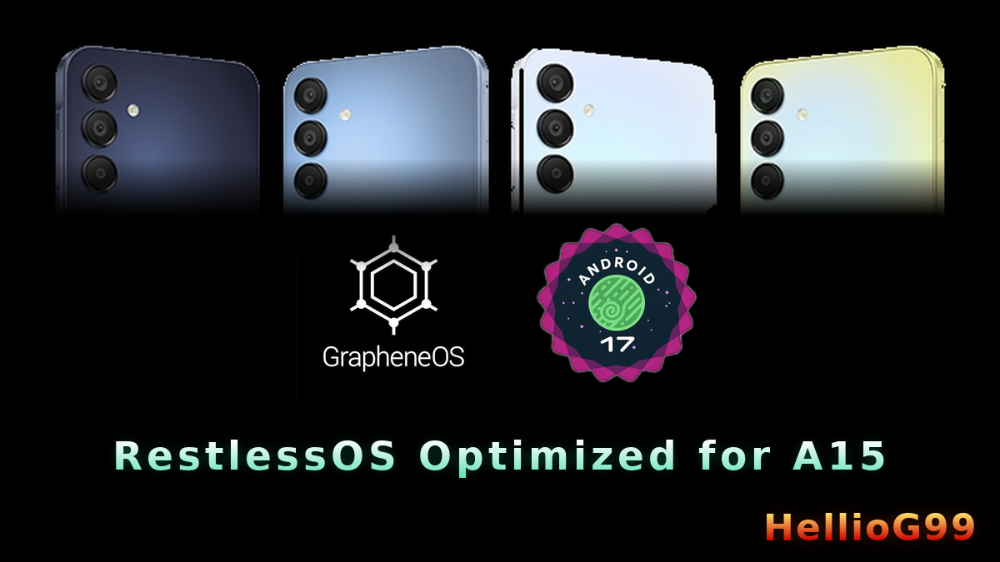

  

# SM-A155F Privacy Project — Custom Kernels + RestlessOS (GrapheneOS-based)

Device-specific software for the **Samsung Galaxy A15 4G (SM-A155F)** — MediaTek **Helio G99 (MT6789)**, Linux 5.10 GKI. **Not** for the A15 5G (SM-A156x).

> ⚠️ **Status: build-tested, NOT device-tested.** Kernels compile, repack, and sign cleanly; nobody has booted them on hardware yet. Unlocked bootloader required. You flash at your own risk — keep your stock `boot.img` to recover.

---

---

## 📱 THE ROM IS OUT — RestlessOS 17 (GrapheneOS fork) for Galaxy A15 4G

**Download:** [Release rom-v1.0 — *1.1 ROM Initial Build*](https://github.com/MuhammedAliMizrakTR/GrapheneOS-SM-A155-/releases/tag/rom-v1.0)

A complete, Odin-flashable privacy ROM that pairs **RestlessOS 17** (Android 17, GrapheneOS-fork GSI — sandboxed Google Play, per-app network/sensors permissions, Seedvault, TrebleApp) with this project's v1.0 kernels and the **untouched stock driver stack** (camera, Mali GPU, audio, GPS, FM, sensors) from Samsung's `A155FXXS7CYG4` firmware. Single **AP** package — no fastbootd, no manual partition juggling.

**What the build does** (fully automated by [`build-rom.yml`](.github/workflows/build-rom.yml)):

1. Fetches the pinned v1.0 kernel artifact (SHA-256-verified), the RestlessOS GSI (SHA-512-verified), and the stock firmware.
2. Unpacks the stock `super.img`, swaps **system** for the RestlessOS GSI, keeps **vendor/product/odm** byte-identical (all drivers preserved), and rebuilds super with `lpmake`.
3. Embeds the **SIM-fix module** (`RILFix_A15`, rooted variants) at `/system/etc/a155f-extras/` — the community-proven workaround for the ~7h25m ril-daemon hang on unlocked A15 4G.
4. Generates verification-disabled `vbmeta`/`vbmeta_system` (avb flags 3) so the modified images boot.
5. Repacks everything into a stock-layout Odin `AP_*.tar.md5` (member order preserved), split into <2 GB parts with SHA-256 sums.

| Variant | Root manager | SIM fix |
|---|---|---|
| **bakasu** | ReSukiSU (BakaSU) | ✅ embedded |
| **kernelsunext** | KernelSU-Next | ✅ embedded |
| **vanilla** | — (unrooted) | ❌ not possible |

**Install:** flash stock `A155FXXS7CYG4` (BL+AP+CP+CSC) in Odin → join the 3 parts (`copy /b` on Windows / `cat` on Linux) → flash the joined tar in the **AP** slot → **format data**. Full guide + verification hashes are in the [release notes](https://github.com/MuhammedAliMizrakTR/GrapheneOS-SM-A155-/releases/tag/rom-v1.0).

## 🔧 Kernels — v1.0 Initial Build

**Download:** [Release v1.0](https://github.com/MuhammedAliMizrakTR/GrapheneOS-SM-A155-/releases/tag/v1.0) (Odin-ready `.tar`, flash in the **AP** slot)

| Variant | Root | Package |
|---|---|---|
| **Vanilla** (unrooted) | — | `stock_optimized_5.10.226_A155FXXS7CYG4_A15_GKI.tar` |
| **BakaSU** | BakaSU 35262 + SUSFS v2.4.0 (built-in) | `bakasu_35262_susfs_v2.4.0_A155FXXS7CYG4_A15_GKI.tar` |
| **KernelSU-Next** | KernelSU-Next 33548 + SUSFS v2.4.0 | `kernelsunext_33548_susfs_v2.4.0_A155FXXS7CYG4_A15_GKI.tar` |

### All variants include

- **Base:** Linux `5.10.226-android12-9-31117096`, GKI `android12-5.10` (KMI 9), built from Samsung's A155F open-source drops with the hermetic **clang-r416183b** toolchain
- **Reproducible builds:** three independent clean builds produced byte-identical kernel images (`Image.gz` sha256 `b5a4dc9b…6809`)
- **BBRv3** TCP congestion control (backported), Cake/fq_codel qdiscs
- **Baseband Guard (BBG)** — LSM-based protection of critical (baseband) partitions
- **NTSync** — high-performance sync primitives (Windows-NT-compatible API, helps emulation/wine-like workloads)
- **Droidspaces** support — portable Linux containers (user namespaces, SYSVIPC, POSIX mqueue fixes)
- **Unicode bypass fix** — blocks path-traversal via non-printable Unicode codepoints
- **zram / memory / scheduler / wakelock optimization patch set** (zram fixes, cache-pressure and wakeup-time reductions, f2fs/ext4 tuning)
- **WireGuard** VPN support in-tree
- Vendor modules built in-tree: **Mali GPU (valhall r32p1), GPS, FM radio, connectivity (conninfra), sensors, camera VCM/ois drivers**
- Samsung lockdown features disabled (RKP, KDP, DEFEX, FIVE, PROCA) — required for custom kernels on this platform
- AVB re-signed with a project-generated key (hence: unlocked bootloader required)

### Root manager apps (install after flashing a rooted variant)

The matching manager APK ships **inside the ROM release** (see the [rom-v1.0 release](https://github.com/MuhammedAliMizrakTR/GrapheneOS-SM-A155-/releases/tag/rom-v1.0)) — use that one, not a random upstream build, so the manager version matches the kernel-side driver (BakaSU 35262 / KernelSU-Next 33548). Sources: [Baka-SU/BakaSU](https://github.com/Baka-SU/BakaSU) · [KernelSU-Next/KernelSU-Next](https://github.com/KernelSU-Next/KernelSU-Next)

---

## 🛡️ The ROM: RestlessOS — GrapheneOS, ported (Android 17)

[RestlessOS](https://github.com/cawilliamson/treble_restlessos) is an **unofficial, unaffiliated GrapheneOS fork** packaged as a Treble GSI. Our plan (decision D009): pair the RestlessOS **arm64-ab** system image with **our matched A155F kernel** above and the **stock CYG3 vendor/driver stack** — a device-specific bundle instead of a bare generic GSI.

### What RestlessOS carries from GrapheneOS

- **Hardened userspace** (GrapheneOS's AOSP hardening patches)
- **Sandboxed Google Play** (GmsCompat) — official Play services/Store run as ordinary, fully sandboxed apps; no privileged GApps, no microG substitute
- **Per-app network / sensors permissions** and other GrapheneOS privacy toggles
- **Seedvault** backup, GrapheneOS **Apps** store client (Vanadium installable from it; no browser preinstalled)
- **TrebleApp** hardening switches for features that are optional on non-Pixel hardware

### Honest limitations (by design of any GSI)

- **No GrapheneOS-equivalent security.** Vendor firmware, kernel (unless replaced), and HALs stay Samsung's; no hardware attestation; verified boot stays rooted in Samsung's bootloader.
- Not included: firmware updates, GrapheneOS kernel hardening (Pixel-specific), hardened_malloc (breaks 39-bit VA devices), Auditor, USB port protection.
- **Android 17 GSI on an Android 15 vendor (CYG3)** — VINTF/ABI compatibility must be validated on-device; expect rough edges.
- Release tracked: [`17.0.0-202611021750`](https://github.com/cawilliamson/treble_restlessos/releases/latest) (`RestlessOS-arm64-ab-…img.xz`).

### 📦 One-package install (no fastbootd)

The ROM ships as a **single Odin AP package** built by CI (`.github/workflows/build-rom.yml`): RestlessOS as `system` inside a rebuilt `super`, the **v1.0 kernel** (pulled from Release v1.0, SHA-256-pinned), the **stock CYG4 driver stack** (vendor/product/odm carried byte-identical), disabled `vbmeta`, and an **embedded SIM-drop fix** module (`/system/etc/a155f-extras/RILFix_A15.zip`, rooted variants). Install: flash stock **A155FXXS7CYG4** (any region) → flash our AP package → format data. Full story: [docs/ROM_BUILD.md](docs/ROM_BUILD.md). Status: **CI-ready, not device-tested.**

---

## 📋 Requirements & flashing overview

1. **SM-A155F**, unlocked bootloader (OEM unlocking → download mode unlock).
2. Back up — and keep your **stock `boot.img`** (from your AP package) for rollback.
3. Kernel: Odin → AP slot → the variant `.tar`. Rooted variants: install the matching manager APK after boot.
4. ROM (later phase): RestlessOS arm64-ab GSI to the system partition + our kernel — full guide lands after the first successful on-device validation.

## 🗺️ Project docs

| File | Purpose |
|---|---|
| [PROJECT_STATE.md](PROJECT_STATE.md) | Live status, evidence ledger, blockers |
| [CHANGELOG.md](CHANGELOG.md) | Verified history of builds/releases |
| [docs/DECISIONS.md](docs/DECISIONS.md) | Decision record (D001–D009) |
| [docs/RESEARCH.md](docs/RESEARCH.md) | Source research & provenance |
| [docs/ROADMAP.md](docs/ROADMAP.md) | Phases and acceptance gates |
| [docs/DEVICE_INVENTORY.md](docs/DEVICE_INVENTORY.md) | Read-only device data collection |
| [AGENTS.md](AGENTS.md) | Contribution/checkpoint protocol |

## ⚖️ License & credits

- This repository's docs/scripts: **Apache-2.0** (see [LICENSE](LICENSE)). Upstream components keep their own licenses (kernel: GPL-2.0; GrapheneOS: mostly MIT; RestlessOS build system: Apache-2.0).
- Kernel source: [poqdavid/android_kernel_samsung_sma155f](https://github.com/poqdavid/android_kernel_samsung_sma155f) · ROM base: [cawilliamson/treble_restlessos](https://github.com/cawilliamson/treble_restlessos) · [GrapheneOS](https://grapheneos.org/) · [TrebleDroid](https://github.com/TrebleDroid) · [KernelSU-Next](https://github.com/KernelSU-Next/KernelSU-Next) · [BakaSU](https://github.com/Baka-SU/BakaSU) · [SUSFS](https://gitlab.com/simonpunk/susfs4ksu)
- Not affiliated with Samsung, Google, GrapheneOS, LineageOS, or the above projects.
