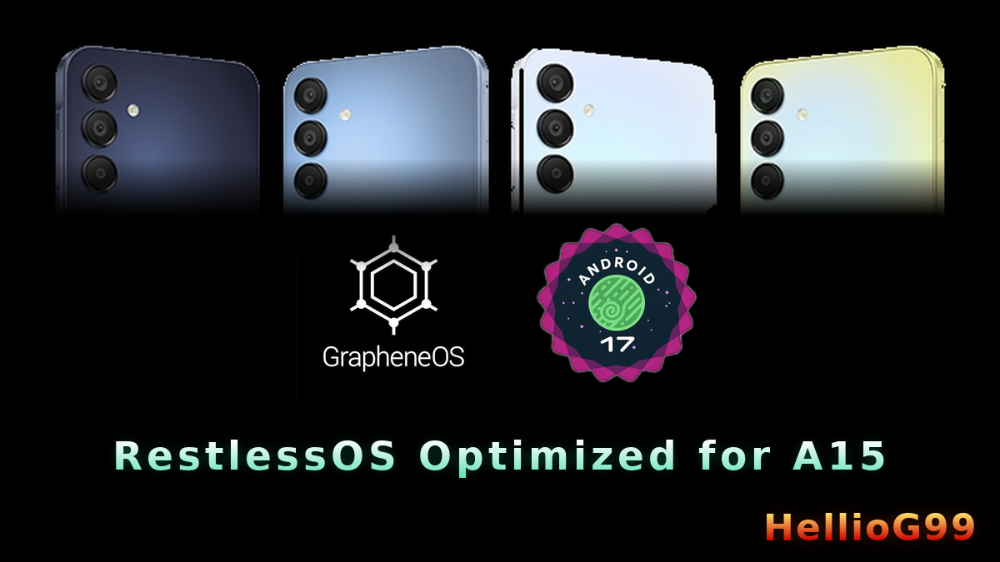

# RestlessOS 17 (GrapheneOS fork) — Galaxy A15 4G (SM-A155F) — 1.1 ROM Initial Build

This release offers three complete, Odin-flashable ROM variants for the **Galaxy A15 4G / SM-A155F**. The system is RestlessOS `17.0.0-202611021750` (Android 17, an unofficial GrapheneOS-fork Treble GSI); each package uses this project's v1.0 kernel variant and the Samsung A155F CYG4 vendor/driver stack. These are community builds, not official GrapheneOS releases.

## Choose ONE variant

| Variant | Kernel/root | Manager | SIM-drop workaround |
|---|---|---|---|
| **bakasu** | BakaSU rooted kernel | BakaSU **35262** APK is attached separately below | Root-dependent module is included; install it after boot |
| **kernelsunext** | KernelSU-Next rooted kernel | Matching KernelSU-Next **33548** APK is a separate attachment; maintainer upload pending | Root-dependent module is included; install it after boot |
| **vanilla** | Stock-optimized, unrooted kernel | None | Not available; the workaround requires root |

Do not combine parts from different variants. Each AP archive is split into three files (`.00`, `.01`, `.02`); download all three parts for the same exact filename prefix.

| Variant | AP filename prefix | Checksum manifest |
|---|---|---|
| BakaSU | `AP_SM-A155F_RestlessOS-17.0.0-202611021750_bakasu_A155FXXS7CYG4.tar.md5` | `SHA256SUMS.txt` (original BakaSU release manifest) |
| KernelSU-Next | `AP_SM-A155F_RestlessOS-17.0.0-202611021750_kernelsunext_A155FXXS7CYG4.tar.md5` | `AP_SM-A155F_RestlessOS-17.0.0-202611021750_kernelsunext_A155FXXS7CYG4.SHA256SUMS.txt` |
| Vanilla | `AP_SM-A155F_RestlessOS-17.0.0-202611021750_vanilla_A155FXXS7CYG4.tar.md5` | `AP_SM-A155F_RestlessOS-17.0.0-202611021750_vanilla_A155FXXS7CYG4.SHA256SUMS.txt` |

### Manager APKs (separate from the AP archives)

- **BakaSU 35262:** [`BakaSU_v4.2.0-rc3_35262-arm64-v8a-release.apk`](https://github.com/MuhammedAliMizrakTR/GrapheneOS-SM-A155-/releases/download/rom-v1.0/BakaSU_v4.2.0-rc3_35262-arm64-v8a-release.apk). This exact manager version matches the BakaSU kernel driver.
- **KernelSU-Next 33548:** the matching official-signature APK is to be attached separately by the maintainer. Do not install an older upstream manager APK or the spoofed CI APK.
- The manager APK is deliberately not baked into any system image, preventing a stale manager version from being silently bundled.

## Installation (Odin)

1. Confirm the phone is **SM-A155F (4G)**. These files are not for SM-A156x / Galaxy A15 5G.
2. Flash stock **A155FXXS7CYG4** firmware in Odin using the complete BL + AP + CP + CSC package, then let stock Android boot once. Keep a known-good stock recovery path.
3. Download all three parts of exactly one variant and its checksum manifest. Verify every part before joining:
   - Linux/macOS: `sha256sum -c <variant-manifest>`
   - Windows: compare each part's SHA-256 from `Get-FileHash <file> -Algorithm SHA256` with the matching line in the manifest.
4. Join the three same-prefix parts in numeric order (`.00`, `.01`, `.02`) into the matching `.tar.md5` file:
   - Windows Command Prompt: `copy /b <same-prefix>.00+<same-prefix>.01+<same-prefix>.02 <same-prefix>`
   - Linux/macOS: `cat <same-prefix>.00 <same-prefix>.01 <same-prefix>.02 > <same-prefix>`
5. Enter Download Mode, select the joined file in Odin's **AP** slot, and flash. Afterward, format data / factory-reset from recovery before first boot.
6. For a rooted variant, install its exact matching manager APK from this release. To enable the SIM workaround, open the manager → Modules → Install from storage → `/system/etc/a155f-extras/RILFix_A15.zip`, then reboot if the manager requests it. **Vanilla has no root and cannot install this module.**

## What is included

- RestlessOS GSI as the system image: sandboxed Google Play (GmsCompat), per-app network/sensor controls, Seedvault, and TrebleApp.
- Samsung/MediaTek A155F vendor/product/odm driver stack carried from CYG4 firmware.
- The selected project's v1.0 kernel: BBRv3, BBG, NTSync, Droidspaces, and WireGuard.
- `RILFix_A15.zip` embedded in rooted images and separately attached; it periodically restarts the vendor RIL as a workaround for the known long-uptime SIM/network hang.

## Limitations

- This is an unofficial RestlessOS/GrapheneOS-fork GSI project, not a GrapheneOS-supported device or official GrapheneOS port.
- VoLTE/MTK IMS is not guaranteed on a GSI; Samsung OTA updates, verified boot, and hardware attestation are not provided.
- The SIM workaround is root-dependent and does not fix the underlying Samsung/MediaTek RIL issue. The Vanilla variant cannot use it.
- Bootloader must remain unlocked for these modified images. Flashing is at your own risk; back up important data and preserve a stock recovery path.

## Verification and credits

- Kernel tar input: exact v1.0 release artifact, SHA-256-pinned in the build workflow.
- GSI: RestlessOS `17.0.0-202611021750`, verified against upstream SHA-512.
- Every AP split part has a SHA-256 entry in its manifest.
- Credits: RestlessOS by cawilliamson; A155F kernels by poqdavid; Samsung stock firmware by Samsung.
